# GameGuide brand kit



An angular **G** (chamfered like the site's game-UI buttons) holding the brand
**diamond**: the waypoint that tells you where to go next. Ink `#EDE8DE`, gold
`#D9A649`, night `#0B0E14` (never pure black). Wordmark: Archivo, weight 760,
width 112%, tracking −0.025em.

On the site and in the chat the diamond takes the accent of the game on
screen; everywhere else it is gold.

## Which file where

| Where | File |
|---|---|
| Product Hunt, Peerlist, LaunchBuff, bot lists, AI directories (square logo) | `../launch/assets/logo-240.png`, `logo-480.png`, or `icon-1024.png` |
| Anywhere that wants a rounded app icon | `../launch/assets/logo-512-rounded.png`, `icon.svg` |
| Header / banner slots (wide) | `lockup-card.png` (1200×400) |
| Logo on a dark page or slide | `lockup-on-dark.png`, `mark.svg` |
| Logo on a white page (Razorpay/PayPal branding, docs) | `lockup-on-light.png`, `mark-on-light.svg` |
| Discord avatar and app icon | `discord-avatar.png` (applied by `discord-bot/scripts/brand-discord.js`) |
| Discord profile banner | `discord-banner.png` (applied by the same script) |
| Social preview (link cards, GitHub social preview) | `../public/og.png` (1200×630) |

## Changing it

The geometry lives in one place, `src/site/brandMark.js`. After editing it:

```bash
node brand/render.mjs                      # every icon, card and logo
node discord-bot/scripts/brand-discord.js  # push the new avatar/banner/icon to Discord
npm test                                   # tests/brand.test.mjs fails if anything drifted
```
